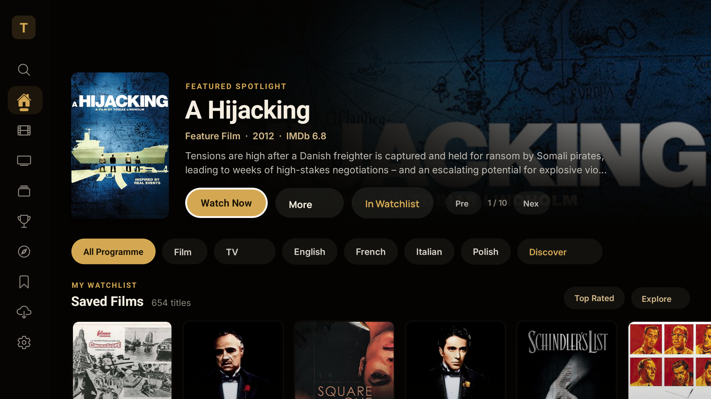
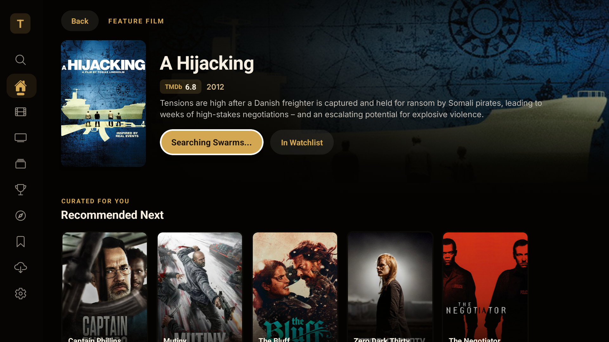
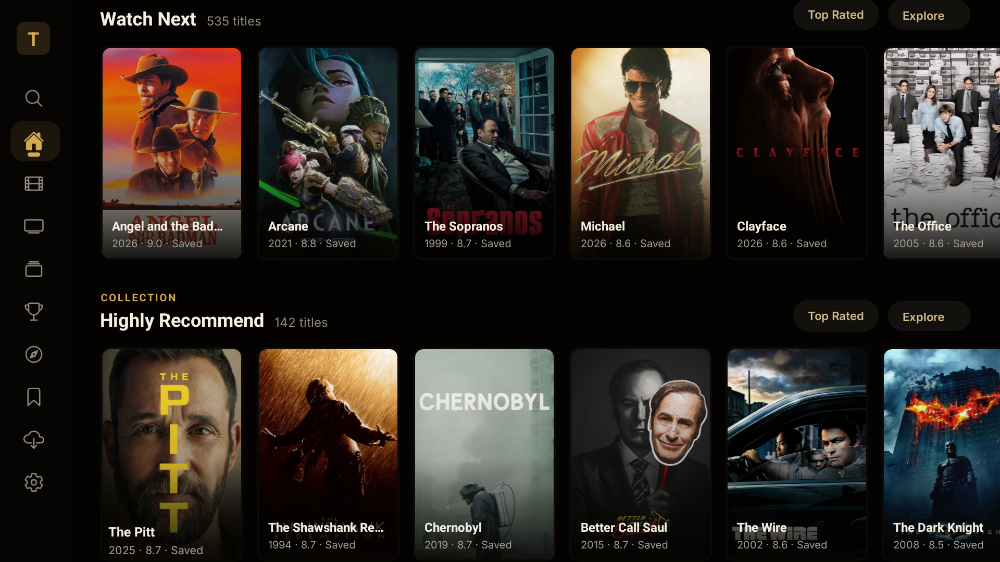
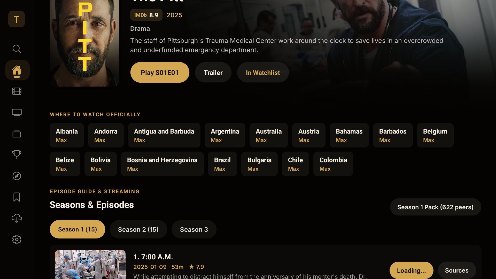

# Trova TV 🎬📺

[](https://developer.android.com/tv)
[](https://reactnative.dev)
[](https://developer.android.com/design/ui/tv)
[]()
[]()
[](LICENSE)

Trova TV is a cinema and streaming discovery application designed for 10-foot living-room displays, Android TV, and Google TV. Re-architected to the visual and ergonomic standards of premier television streaming platforms (Netflix, HBO Max, BBC iPlayer, Apple TV+), Trova TV delivers a seamless cinematic experience with hardware D-pad navigation, high-resolution theatrical key-art, and transparent global streaming availability.

<p align="center">
  
</p>

---

## 📸 Screen Showcase

| Theatrical Hero Billboard | Where to Watch Officially |
|:---:|:---:|
|  |  |
| *Widescreen 4K backdrop, official title logo treatment & 2:3 vertical poster card* | *Country-by-country streaming provider matrix with explicit regional names* |

| Synchronized Discover Matrix | Seamless Watchlist Canvas |
|:---:|:---:|
|  |  |
| *Reactive faceted filtering across films, TV shows, genres & release eras* | *Cross-device synchronized watchlist on deep `#040301` cinema black* |

---

## 🌟 Living-Room Canvas & Design Philosophy

Trova TV departs from mobile-adapted interfaces and harsh boxy container cards. Designed from the ground up for OLED and high-contrast television panels:

* **Seamless Dark Canvas (`#040301`)**: Eliminates visual clutter, heavy borderlines, and boxed containers. Content, typography, and posters float naturally over deep cinema black.
* **10-Foot Typography & Tonal Contrast**: Text sizes and metadata lines are tuned for legibility from 3 meters away. High-emphasis typography is balanced by borderless, subtle tonal pill backgrounds (`rgba(255, 255, 255, 0.08)`).
* **Information-First Minimalism**: Removes redundant icons and emoji clutter. If a label or metadata point is self-explanatory (*"Top Rated"*, *"Watch Now"*, *"Films"*), it renders purely through balanced typography without visual noise.
* **Apple TV-Grade Billboard Stage**: A prominent 2:3 theatrical vertical poster card paired with a 4K textless backdrop, multi-directional gradient transitions, dynamic official title logo treatment, and immediate playback triggers.

---

## ✨ Key Capabilities

### 1. 4K Theatrical Hero Spotlight
* Dynamic TMDb backdrop acquisition with high-res textless 4K key-art.
* Automated vector and transparent PNG title logo treatment overlay.
* Live metadata synthesis: release year, MPAA/content rating, duration, multi-genre chips, and rich plot synopsis.
* Dedicated action pills: direct trailer launch, content detail navigation, and instant watchlist toggle.

### 2. Transparent "Where to Watch Officially" Matrix
* Replaces cryptic icon glyphs with explicit, readable country names (*Canada*, *United States*, *United Kingdom*, *Sweden*, *Germany*, *Australia*).
* Direct provider labels (*Prime Video*, *Netflix*, *Disney+*, *Apple TV+*, *Crave*, *Paramount+*).
* Comprehensive regional catalog resolution powered by synchronized streaming availability lookups.

### 3. Integrated Discover Matrix
* Real-time facet selection across **Films** and **TV Series**.
* Granular filtering by release decades (*2020s*, *2010s*, *Classic Eras*), IMDb & TMDb rating thresholds, and 19+ distinct cinematic genres.
* Instant query reconciliation: updates immediately upon remote selection without debounce latency or UI freezing.

### 4. Dedicated Native TV Player & Activity Lifecycle
* Built on a dedicated Android TV player activity (`TrovaPlayerActivity`) with native hardware acceleration.
* Explicit task-stack separation prevents video playback from stripping Android TV leanback mode or collapsing into mobile portrait orientations.
* Automatic return to the 10-foot navigation stage on playback completion or exit.

### 5. Universal D-Pad Navigation & Focus Engine
* Designed entirely for directional remotes (Up, Down, Left, Right, Select/Enter, Back, Play/Pause).
* Smooth elevation, scale transforms, and contrast accents on focused tiles.
* Automatic horizontal and vertical scroll alignment prevents focused cards from escaping television overscan bounds.

### 6. Mobile Watchlist Synchronization
* Cross-device portability: export watchlists from Trova Mobile directly to Trova TV via local network ADB or pairing profiles.
* Unified watchlist screen with quick-clear and jump-to-stream functionality.

---

## 🎮 Remote Control & Keybinding Reference

| D-Pad Input | Action | Behavior |
|:---|:---|:---|
| **D-Pad Left** | Navigation Sidebar | Slides out navigation drawer with Home, Discover, Search, Watchlist, Settings |
| **D-Pad Right** | Content Canvas | Transitions focus into featured billboard or horizontal content rails |
| **D-Pad Up / Down** | Rail Navigation | Smoothly scrolls between theatrical rows (Trending, Top Rated, Franchises, Filmographies) |
| **Center / Enter** | Select / Open | Opens detail screen, toggles discover filter, or initiates immediate trailer playback |
| **Play / Pause** | Instant Play | Launches fullscreen native video trailer directly from card focus |
| **Back Button** | Back / Escape | Returns from player to detail view, or from detail view to main canvas |

---

## 🏗️ Architecture & Component Layout

```
trova/
├── android/                   # Native Android TV Gradle project & manifest configurations
│   ├── app/src/main/
│   │   ├── AndroidManifest.xml # Configured with LEANBACK_LAUNCHER and TV banner
│   │   └── java/.../          # MainActivity and TrovaPlayerActivity classes
├── src/
│   ├── tv/                    # 10-foot Leanback React Native TV UI Engine
│   │   ├── TvHomeScreen.js    # Cinematic landing screen with rails and hero billboard
│   │   ├── TvHeroBillboard.js # Theatrical 2:3 poster, 4K backdrop, and title treatment logo
│   │   ├── TvDetailScreen.js  # Where to watch country matrix, credits, and synopsis
│   │   ├── TvDiscoverScreen.js# Reactive faceted search with media, genre, and year filters
│   │   ├── TvSearchScreen.js  # On-screen TV keyboard and instant search query handler
│   │   ├── TvWatchlistScreen.js# Borderless watchlist manager
│   │   ├── TvPosterCard.js    # Focusable television poster component with scale animations
│   │   ├── TvContentRail.js   # Horizontally scrolling content carousel with auto-centering
│   │   └── TvSidebar.js       # Minimalist persistent TV navigation rail
│   ├── lib/                   # Shared cinema core engines & data stores
│   │   ├── tmdb.js            # TMDb 4K backdrops, logos, credits, and trailer resolver
│   │   ├── discoverViewModel.js # Reactive discover query engine and state machine
│   │   ├── wikidataTheatrical.js # SPARQL theatrical verification engine
│   │   └── availability.js    # Multi-country streaming platform availability provider
│   └── data/                  # Static awards registries and curated cinema anthologies
└── tests/                     # 563 automated unit tests verifying core logic
```

---

## 🚀 Getting Started

### Prerequisites
* **Node.js**: v18.x or v20.x LTS
* **Android SDK**: API Level 34 with Android TV (Leanback) SDK platform tools
* **Java Development Kit**: OpenJDK 17
* **Android TV / Google TV Device**: Connected via ADB over Wi-Fi or USB

### Installation

1. **Clone the repository**:
   ```bash
   git clone https://github.com/visual-zimbabwe/trova-tv.git
   cd trova-tv
   ```

2. **Install project dependencies**:
   ```bash
   npm install
   ```

3. **Configure Environment Variables**:
   Copy `.env.example` to `.env` and provide your API keys:
   ```env
   TMDB_API_KEY=your_tmdb_api_key_here
   OMDB_API_KEY=your_omdb_api_key_here
   ```

4. **Run Unit Tests**:
   Ensure all 563 cinema and navigation unit tests pass:
   ```bash
   npm test
   ```

---

## 📺 Building & Deploying to Android TV

### Connect Your Television
Ensure **Developer Options** and **Network Debugging** are enabled on your Android TV:
```bash
adb connect <YOUR_TV_IP_ADDRESS>:5555
# Example: adb connect 10.0.0.230:42547
adb devices
```

### Compile Release APK
Build the optimized standalone Android TV APK:
```bash
cd android
./gradlew assembleRelease
```

### Install onto Device
```bash
adb -s <YOUR_TV_IP_ADDRESS> install -r app/build/outputs/apk/release/app-release.apk
```

### Launch on TV
```bash
adb -s <YOUR_TV_IP_ADDRESS> shell am start -n kkadogo.findstreamer.com/.MainActivity
```

---

## 🧪 Testing & Verification

The test suite validates data transformation, SPARQL queries, caching layers, and discover logic:
```bash
npm test
```
```
ℹ tests 563
ℹ suites 0
ℹ pass 563
ℹ fail 0
ℹ duration_ms ~980ms
```

---

## 🛡️ Contribution & Branch Protection

Main branch integrity is enforced:
* Direct pushes to `main` are disabled.
* All changes require an approved Pull Request with passing test pipelines.

---

## 📄 License

This project is open-source under the [MIT License](LICENSE).
